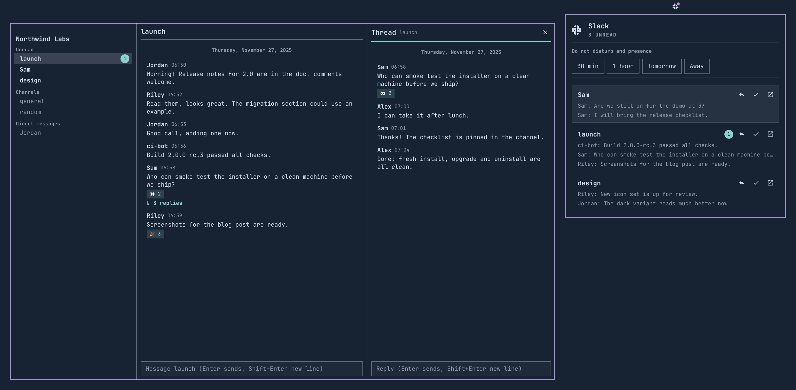

# omaslack for the Omarchy shell

Slack in the Omarchy bar: an unread dot, a quick panel for replying
without leaving what you are doing, and a full window. Plugin ID
`ar.scabb.omaslack`.



The plugin is one of two clients of the omaslack daemon; the other is
`omaslack tui`, a terminal client. The daemon is the only part that talks
to Slack and keeps your credentials, so the bar, the window and the TUI
always agree on what is read.

- **Bar icon.** A dot lights when something is unread. The tooltip lists
  the counts per workspace (DMs, mentions, channels, threads). The glyph
  changes while omaslack reconnects, when a sign-in expires and during
  do not disturb. Left-click opens the quick panel, right-click opens the
  window (or the TUI), and middle-click retries the daemon right away.
- **Quick panel.** Unread conversations, DMs and mentions first, each
  with its latest messages. Reply, mark as read or open each one, and
  snooze notifications or set yourself away. Previews never mark
  anything read.
- **Window.** Workspaces and conversations in a sidebar, the conversation
  and its thread side by side, reactions, edits, deletes, files, search
  and a conversation finder, all from the keyboard.

## Requirements

- Omarchy with its Quattro shell (`omarchy-shell`).
- The `omaslack-bin` package from the AUR, which provides the `omaslack`
  binary and its systemd user service. The plugin does not include it.

  ```bash
  omarchy-pkg-aur-add omaslack-bin
  ```

- A one-time setup and at least one workspace:

  ```bash
  omaslack setup       # theme template and hook, enables and starts the user service
  omaslack auth add    # sign in to a workspace (run it once per workspace)
  omaslack doctor      # checks everything and prints the fix for each problem
  ```

If any of this is missing, the plugin says so: the bar tooltip names the
problem and the command, and the quick panel offers a button for it.

| What the plugin finds | What the panel offers |
| --- | --- |
| `omaslack-bin` not installed | **Install omaslack-bin**: `omarchy-pkg-aur-add omaslack-bin` in a floating terminal |
| An `omaslack` older than the plugin | **Update omaslack-bin**: `yay -S --needed omaslack-bin`, then restarts the service, in a floating terminal |
| An `omaslack` newer than the plugin | How to update the plugin (no button) |
| A running daemon older than the installed binary | **Restart the daemon**: `systemctl --user restart omaslack` |
| Installed, but the user service is not enabled | **Set up omaslack**: `omaslack setup` in a floating terminal |
| Installed and set up, but the daemon is not running | **Start the daemon**: `systemctl --user start omaslack` |

Package commands always run in a terminal you can see, where you confirm
them with your password. The plugin never installs anything silently.

## Install

`omarchy plugin add <git-url>` expects `manifest.json` at the root of the
repository it clones. omaslack keeps the plugin in the `plugin/`
directory of its main repository, next to the daemon and the TUI, so
that command cannot install it from there yet. Until the plugin is
published in a repository of its own, install it from a clone:

```bash
git clone https://gitlab.com/scabb-island/omaslack.git ~/.local/share/omaslack-plugin
mkdir -p ~/.config/omarchy/plugins
ln -s ~/.local/share/omaslack-plugin/plugin ~/.config/omarchy/plugins/ar.scabb.omaslack
omarchy-shell shell rescanPlugins
omarchy plugin enable ar.scabb.omaslack --section right
```

Once it is published on its own, this becomes:

```bash
omarchy plugin add <plugin repository URL> --enable
```

To update a clone:

```bash
git -C ~/.local/share/omaslack-plugin pull
omarchy restart shell   # the shell keeps the plugin's service loaded until it restarts
```

## Placing it in the bar

`omarchy plugin enable` puts the icon in the bar's right section. To move
it:

```bash
omarchy bar move ar.scabb.omaslack --section right --index 0
omarchy bar move ar.scabb.omaslack --section tray     # into the tray's drawer
```

The sections are `left`, `centerBegin`, `center`, `centerEnd`, `tray` and
`right`.

## Settings

Change them in the shell's bar settings, or from a terminal with
`omarchy bar set ar.scabb.omaslack <key> <value>`:

| Key | Values | Default | What it does |
| --- | --- | --- | --- |
| `unreadScope` | `all`, `dms-and-mentions` | `all` | What lights the dot: every unread conversation, or only DMs and mentions. The tooltip and the panel always list everything. |
| `openWith` | `window`, `tui` | `window` | Where right-clicking the icon or picking a conversation in the panel opens it. |
| `hideWhenEmpty` | `true`, `false` | `false` | The icon leaves the bar while nothing is unread. It stays during do not disturb and whenever something needs your attention. |

Desktop notifications (on or off, keywords, channels that always or
never notify, and whether a click opens the window or the TUI) are set
in the `[notifications]` table of `~/.config/omaslack/config.toml`, the
daemon's configuration, so they apply to every client.

## Keyboard

Quick panel: `↑` `↓` (or `j` `k`) move between conversations, and up from
the first one into the do not disturb buttons (`←` `→` across them).
`Enter` opens a conversation or presses a button, `r` or `Tab` replies,
`x` or `Delete` marks as read, `d` jumps to do not disturb and `Esc`
closes. While omaslack is not installed or not running, `Enter` runs the
offered action.

Window: `?` shows every key. The main ones are `Tab` to move between the
sidebar, the conversation and the thread; `j` `k` to move; `Enter` to
open; `i` to write; `R` to reply in a thread; `e` to edit; `D` to delete;
`r` to react; `Ctrl+K` to find a conversation; `/` to search; and `Esc` to
step back.

omaslack binds no global keys. Suggested Hyprland bindings for showing
the window and opening the TUI, the launcher entry and the window rule
that makes the window float are in the
[Omarchy integration guide](../packaging/omarchy/README.md).

## Removing everything

Run these in order: the credentials go first, while `omaslack` is still
installed.

1. Remove each workspace's credentials from the keyring:

   ```bash
   omaslack auth list
   omaslack auth remove <team-id>     # once per workspace
   ```

2. Undo `omaslack setup`: this disables the user service and removes the
   theme template, the theme hook and the window rule it installed (files
   you edited are left for you to delete):

   ```bash
   omaslack setup --remove
   ```

   If you added `require("hypr.omaslack")` to `~/.config/hypr/hyprland.lua`
   or the suggested shortcuts to `~/.config/hypr/bindings.lua`, remove
   those lines too.

3. Remove the plugin:

   ```bash
   omarchy plugin remove ar.scabb.omaslack
   rm -rf ~/.local/share/omaslack-plugin    # the clone, if you installed from one
   ```

4. Remove the package:

   ```bash
   sudo pacman -Rns omaslack-bin
   ```

5. Delete omaslack's data: the message stores, the configuration (and
   the file keyring used where no Secret Service is available), the
   downloaded files and the rendered theme:

   ```bash
   rm -rf "${XDG_DATA_HOME:-$HOME/.local/share}/omaslack" \
          "${XDG_CONFIG_HOME:-$HOME/.config}/omaslack" \
          "${XDG_CACHE_HOME:-$HOME/.cache}/omaslack" \
          ~/.local/state/omarchy/current/theme/omaslack.toml
   ```

After this no systemd unit, hook, template, window rule or credential of
omaslack is left.

## Other Slack clients

omaslack works next to the official Slack app and other Slack plugins:
Slack keeps the read state, so what you read in one is read in the
others. Each client notifies on its own, though, so turn off the
notifications of the ones you keep (or disable the other plugin with
`omarchy plugin disable <its id>`). omaslack never changes another
plugin's configuration. The
[Omarchy integration guide](../packaging/omarchy/README.md#coexistence-with-other-slack-clients)
has the details, including hiding the official app's tray icon.

## License

MIT. See [LICENSE](LICENSE).
